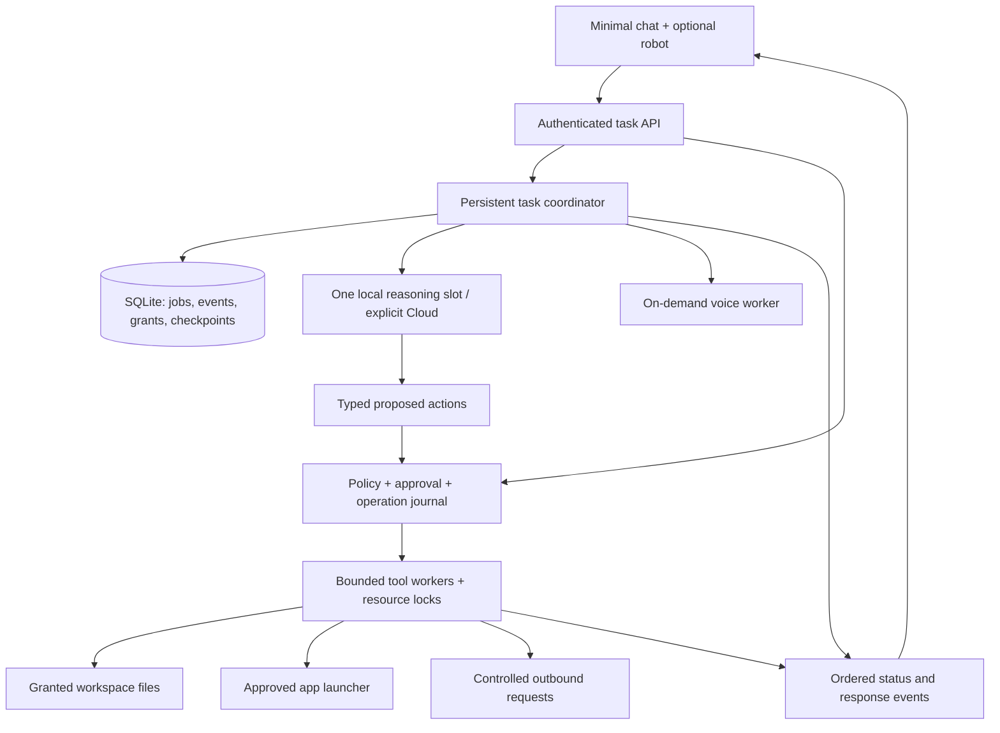

**Jarvis architecture, performance, product and security review**

Reviewed 8 October 2026. Target hardware: Windows, Intel i3 13th generation, 8GB RAM.

The recommended direction is a small local task coordinator with one local reasoning worker, shared services, persistent task state, and a policy-enforcing action service. Retain the minimal chat and optional robot. Make the character a useful interface to tasks, permissions and results.

This is a source review and improvement plan, not an implementation or a penetration-test certification. “100% productive” and perfect security are not credible guarantees. Measure completed, verified tasks, correction effort, latency and resource use. The visual concepts below are proposed combinations; their worldwide originality has not been established.

**Scope and evidence**

Reviewed first-party backend, graph and tool modules, filesystem operations, CLI/voice path, database, browser UI, companion shell/IPC/pointer controls, launch/install scripts, dependency declarations and regression-test coverage. Third-party bundled libraries/runtime binaries, credentials, personal notes and database contents were excluded. No dependency CVE audit or new whole-application performance benchmark was performed.

Harmless checks exercised the file path policy without reading file contents. It permits paths such as .env.local, .aws/credentials, config.json, web_server.py and desktop-companion/.user-data/Preferences under the current workspace, while blocking .env. These checks establish a policy gap; they do not establish that every example file exists.

An initial suspicion about later tools skipping edit preparation was ruled out: the graph explicitly maps the “tools” routing label to the “prepare” node for every remaining call. Preserve this behavior and extend multi-edit regression coverage. See [command_framework/agent/agent_graph.py:160](command_framework/agent/agent_graph.py#L160). Existing test suites were inspected, not rerun as part of this review. No application code or settings were changed.

**What is already worth preserving**

- Plain JavaScript, FastAPI and SQLite are suitable foundations for this hardware.
- The minimal chat, three themes, on-demand drawer, keyboard behavior and Markdown allowlist are good product choices.
- The active Local reasoning path does not silently fall back to Gemini.
- File creation is exclusive; modifications have backups, atomic replacement and stale-content checks.
- Agent approvals use call identifiers and checkpoints to avoid replaying completed calls.
- Electron uses sandboxing, context isolation, disabled Node integration, restricted navigation and checked IPC senders.
- Native pointer leases, renderer-stall recovery, emergency quit and tray recovery address an important real usability failure. Performance work must preserve them.

**Confirmed findings and concrete changes**

P0 means address before expanding autonomy; P1 means the next efficiency/reliability milestone; P2 means an incremental product or packaging improvement. Priorities are engineering judgments, not CVSS scores.

| Priority | Finding and source | Recommended modification |
|---|---|---|
| P0 | The default workspace is the application source directory. The private-name denylist is narrow and relative to the selected root. [command_framework/modules/file_manager.py:14](command_framework/modules/file_manager.py#L14) and [command_framework/modules/file_manager.py:48](command_framework/modules/file_manager.py#L48) | Separate installation, application data and user workspaces. Deny agent access to application code, policy, credentials, browser profiles and backups independently of workspace selection. Choose workspaces through explicit grants. |
| P0 | Authenticated direct create/delete API routes call FileManager without the agent approval mechanism. Frontend confirmation is not a server policy boundary. [web_server.py:485](web_server.py#L485) and [web_server.py:514](web_server.py#L514) | Route UI, agent and CLI mutations through one action service. An explicit UI gesture can authorize a specific staged operation; require a server-issued, single-use decision token rather than trusting an arbitrary DELETE request. Avoid asking twice for the same reviewed action. |
| P0 | Switching providers retains the graph conversation; the next Cloud invocation receives accumulated messages, potentially including previous local file/tool content. [web_server.py:302](web_server.py#L302) and [command_framework/agent/agent_graph.py:190](command_framework/agent/agent_graph.py#L190) | Default Cloud switching to a fresh context, or show a reviewable context-transfer preview. Authorize outbound data, not merely the provider name. Keep each task's provider and data grants stable during a run. |
| P0 | Whisper initialization and consumption of the returned segment iterator occur in the async route. Only the transcribe call itself is offloaded. [web_server.py:198](web_server.py#L198) | Move model load, audio decoding and full iterator consumption to a bounded worker. Later make voice an on-demand process that can unload. Validate or resample audio instead of merely warning about a non-16kHz rate. |
| P0 | Queries, file contents and audio lack comprehensive explicit size/duration/task limits. The audio path reads the full upload into memory. [web_server.py:146](web_server.py#L146) and [web_ui/app.js:627](web_ui/app.js#L627) | Enforce request bytes, decoded samples, recording duration, file bytes, spreadsheet dimensions, task duration, actions and output tokens at server boundaries. Use private temporary storage and bounded buffers. |
| P1 | A global lock rejects concurrent API mutations with 409; there is one active graph thread and one global workspace. [web_server.py:47](web_server.py#L47) and [command_framework/agent/agent_graph.py:90](command_framework/agent/agent_graph.py#L90) | Accept independent jobs into a bounded queue. Snapshot workspace, model, permissions and context per job. Use resource-level write locks rather than a single application-wide lock. |
| P1 | Model calls return only a completed response; history and all tool schemas are passed repeatedly. [command_framework/agent/agent_graph.py:137](command_framework/agent/agent_graph.py#L137) and [command_framework/agent/agent_graph.py:208](command_framework/agent/agent_graph.py#L208) | Stream response/status events; trim context to a token budget; retrieve relevant files; bind relevant tools only. Exact timer/date/UI actions can bypass reasoning entirely. |
| P1 | Graph state uses MemorySaver, whereas SQLite stores separate plain chat messages. Restart recovery is incomplete. [command_framework/agent/agent_graph.py:183](command_framework/agent/agent_graph.py#L183) and [database.py:16](database.py#L16) | Persist task/checkpoint/approval/operation state together with clearly scoped conversations. Do not mistake chat logs for an execution journal. |
| P1 | Reset replaces graph memory but does not clear stored SQLite chat history. [web_server.py:392](web_server.py#L392) and [database.py:65](database.py#L65) | Distinguish “New conversation” from “Delete stored history.” Define retention, backup treatment and privacy semantics explicitly. Do not claim secure erasure from a simple SQL DELETE. |
| P1 | API timers and agent timers use different ReminderManager instances. Each timer creates a polling daemon thread and does not survive restart. [web_server.py:118](web_server.py#L118), [command_framework/agent/agent_tools.py:17](command_framework/agent/agent_tools.py#L17) and [command_framework/modules/reminders.py](command_framework/modules/reminders.py) | Inject one shared scheduler, store due times and delivery state, notify through the event stream, and reconcile sleep/restart behavior. |
| P1 | Explorer recursively builds a tree, then walks it again for counters the minimal UI no longer needs. Work happens in an async route. [web_server.py:406](web_server.py#L406) | Return one directory at a time with pagination and lazy expansion; eliminate unused counts. Run bounded filesystem work off the event loop and cache with explicit invalidation. |
| P1 | A denied/blocked action need not yield a partial/cancelled overall status. Some tools return error text without raising, so a successful invocation can conceal an unsuccessful operation. [command_framework/agent/agent_graph.py:280](command_framework/agent/agent_graph.py#L280) and [command_framework/agent/agent_graph.py:415](command_framework/agent/agent_graph.py#L415) | Standardize typed ToolResult outcomes and verified postconditions. Respect dependency failures. Derive final status and robot gestures from actual outcomes. |
| P1 | Local HTTP authorization bootstraps a cookie for anyone able to fetch the root. Origin/Host checks protect browser boundaries but are not local-process identity. [web_server.py:102](web_server.py#L102) and [web_server.py:547](web_server.py#L547) | Pair the native shell and backend through a private startup channel; use short-lived session credentials and per-session scopes. Keep browser access opt-in and paired. Do not claim protection from a compromised Windows account. |
| P1 | App aliases match substrings and launch fixed command strings using shell=True. [command_framework/modules/system_control.py](command_framework/modules/system_control.py) | Exact application IDs, resolved approved executable paths, shell=False argument arrays where possible, and a separate allowlisted URI launcher. User input is not directly interpolated today; arbitrary shell injection was not demonstrated. |
| P1 | Full tool parameters, results, search queries and voice transcripts can reach logs. Credentials can be loaded from a plaintext legacy key file. | Redact logs by default; store optional saved keys with Windows user-scoped protection; add expiry and revocation. Keep raw data logging an explicit temporary diagnostic option. |
| P2 | The robot still draws continuously at up to 30fps when visible even with quiet idle enabled. [web_ui/robot.js:170](web_ui/robot.js#L170) | Render stationary poses only when dirty; animate during gestures/speech; suspend hidden work; offer a lightweight 2D character mode. Profile hit-testing before replacing full-mesh raycasts with a proxy. |
| P2 | CLI startup calls handler.llm.warm_up(), but CommandHandler defines agent instead. [voice_interface.py:167](voice_interface.py#L167) and [command_framework/command_handler.py:24](command_framework/command_handler.py#L24) | Fix the CLI startup contract or retire the CLI deliberately. Lazy-load audio/TTS dependencies in text-only mode. |
| P2 | Dormant legacy model integration has a separate provider/fallback path; space.js is leftover visual code. Python dependencies are unpinned. [command_framework/modules/llm_integration.py](command_framework/modules/llm_integration.py), [web_ui/space.js](web_ui/space.js) and [requirements.txt](requirements.txt) | Consolidate provider configuration; remove unused code after reference checks; split core/voice/desktop dependencies and lock tested versions. Unused files cost maintenance/disk space, not automatically runtime CPU. |
| P2 | Markdown is loaded from an external CDN; desktop data lives inside the project; forced companion termination can skip owned-backend cleanup. [web_ui/index.html:10](web_ui/index.html#L10) and [desktop-companion/main.cjs](desktop-companion/main.cjs) | Bundle the renderer dependency, tighten CSP, move private app data outside the workspace, and supervise only app-owned child processes with graceful shutdown plus bounded fallback. |

The voice finding follows the library's documented lazy-generator behavior: consuming segments triggers transcription. Offloading only generator creation is insufficient. [faster-whisper documentation](https://github.com/SYSTRAN/faster-whisper#usage)

**Proposed architecture**

Keep this as a modular local application. No Redis, Kubernetes, always-running vector database or fleet of reasoning agents is needed initially.

Suggested boundaries: api/routes, runtime/tasks, runtime/events, runtime/scheduler, models/provider, policy/grants, policy/approvals, tools/files, tools/apps, tools/search, storage and voice/worker. Split browser state, chat rendering, drawers, voice and companion integration into small native ES modules. Use dependency injection so API and graph access the same services.

A Task should carry task_id, conversation_id, parent/dependency IDs, workspace_grant_id, provider/model snapshot, status, budget, cancellation state and timestamps. A proposed action carries a stable operation ID, typed parameters, declared resources, required capability, input provenance and verification rule. Secrets remain outside these records.

Start with one local inference slot and two I/O workers as a conservative configuration to benchmark. Multiple tasks can wait, read independent files, fetch permitted information or run timers while another task reasons. Concurrent reasoning increases memory demand; Ollama documents that parallel contexts increase allocation. [Ollama FAQ](https://docs.ollama.com/faq)

Example: “Research a topic, create a spreadsheet, and remind me in ten minutes.” Register the timer immediately; queue research reasoning; fetch approved sources; schedule the spreadsheet only when its required data is ready. If a file replacement needs approval, park that branch and continue unrelated work. Never parallelize dependent actions merely because the model listed them together.

Queue states should include queued, reasoning, running_tool, awaiting_approval, completed, partial, cancelled, failed and needs_attention. Show why a task is waiting. Use bounded queues with backpressure and fair scheduling so a long task cannot starve short requests.

Introduce POST /api/tasks, GET /api/tasks/{id}, an authenticated event stream, POST /api/tasks/{id}/cancel and scoped approval endpoints. Keep existing endpoints as adapters during migration. Events need sequence IDs, reconnect/replay and client deduplication; scope every task/event read to its authenticated session.

Cancellation stops new side effects at the next safe boundary and interrupts supported model/network calls. Cancelling an awaiting Python thread does not itself stop its work. For hard timeouts, isolate interruptible workers and reconcile in-flight operations before retrying. Do not promise cancellation reverses completed effects.

Persist intent before mutation and result after verification. Stable idempotency keys prevent retries from blindly repeating creates or external actions. After a crash between an external effect and its journal update, mark uncertain and reconcile; do not claim exactly-once execution from checkpointing alone. Persistent graph checkpoints support recovery, but application side effects still need their own protocol. [LangGraph persistence](https://docs.langchain.com/oss/python/langgraph/persistence)

**Make it faster on this machine**

Your measurements give approximately 20.20 generated tokens/sec for 1.5B versus 10.54 for 3B: about 1.92 times the throughput. The total durations are not directly comparable because response lengths differed. At those reported rates, generating 100 tokens alone takes roughly 5 versus 9.5 seconds, excluding prompt evaluation and other work. These are calculations from your measurements, not a fresh benchmark.

1. Evaluate the 1.5B model on representative tool tasks before making it the fast default. Retain explicit 3B/Cloud choices for tasks that need them. Do not infer reliability from speed.
2. Use deterministic handlers for exact date/time/timer requests and direct UI actions. Ambiguous language still goes through reasoning or clarification.
3. Trial concise conversational answers, roughly 80–150 tokens when sufficient; allow separate larger budgets for code, documents and requested detail.
4. Bound context by tokens. Store task summaries and retrieve relevant excerpts rather than repeatedly sending the entire conversation and full file contents.
5. Stream safe Markdown text and public task status. Streaming improves perceived latency; it does not increase raw model throughput. Never execute partial tool-call fragments.
6. Lazy-load heavy imports. Load Whisper only for voice, consume its iterator in the worker, and release the worker after inactivity if measurements justify it.
7. Make recording push-to-talk with duration/sample limits and clear microphone state. Move from ScriptProcessorNode to AudioWorklet when refactoring audio. Speech output should have one cancellation-aware queue.
8. Keep only one selected local model warm; offer a low-memory setting that unloads it after idle time. Balance reload latency against memory rather than forcing one policy on every machine.
9. Stop needless tree scans, defer activity details until expanded, and render long history incrementally. Keep large outputs as bounded artifacts with previews.
10. Fix SQLite connection lifetime explicitly, add busy timeout and measured WAL use, index task/event queries, and enforce retention. Keep the live database in local application data rather than a synced project folder.
11. Benchmark browser-only, Electron 2D and Electron 3D modes first. A WebView2/Tauri shell is a later experiment, not an automatic RAM-saving promise; it must preserve transparent click-through, focus, tray, microphone and emergency controls.

Record total process-tree private memory, system available RAM/paging, CPU, startup time, time to first token, model tokens/sec, task completion latency and correction rate. Include Ollama and voice workers; Electron-only memory is not the application total.

**Strict guardrails: an enforceable action boundary**

The model proposes actions. A separate deterministic service decides whether each action is allowed. Prompt wording and regex patterns are supplemental checks, not authorization.

| Operation | Default boundary |
|---|---|
| Read user content | Only within an explicit read grant; deny credential/profile/application-data roots regardless of workspace selection. Enforce byte limits. |
| Create a file | Explicit create capability, non-existing destination, safe path and content limits. Executable/startup/config destinations require a distinct developer capability or remain denied. |
| Modify a file | Exact reviewed target and diff, mandatory expected content hash, atomic replacement and recoverable backup. |
| Delete a file | Review actual targets and versions, then quarantine with a receipt. Permanent purge is a separate explicit action. |
| Launch an app | Exact approved application ID; no model-provided executable path, shell or arbitrary command-line parameters. |
| Search / Cloud reasoning | Explicit network policy with destination and permitted data scope. Local inference alone does not mean offline operation. |
| Send messages / publish / future integrations | Stage a preview with exact recipient, content and destination; commit through a narrowly scoped user decision. |
| Install tools, modify policy, access secrets or elevate privileges | Deny ordinary agent tools. Use a separate human-controlled administrative workflow. |

Bind approvals to task, action, canonical parameters, workspace grant, target version, policy version and expiration. Consume each decision once. Revalidate immediately before execution; changes require a new review. A narrowly scoped batch can reduce approval fatigue, but a batch must enumerate its actual actions and stop/review when scope changes.

File grants should originate from an explicit user selection and be revocable. Canonicalize both grant roots and destinations; account for Windows case rules, junctions, symlinks, alternate data streams and reserved names. Path checks reduce risk but cannot completely isolate a process with broad OS permissions. Stronger execution isolation requires a restricted worker identity or Windows sandbox boundary; a separate process with the same unrestricted account is not a security sandbox.

Keep untrusted documents, search snippets and model results labelled as data with provenance. They cannot grant capabilities, choose new recipients, broaden a workspace or authorize Cloud transfer. Extract facts in a tool-free context when useful; enforce final authorization outside the model. Test indirect instructions embedded in files and search results. This follows defense-in-depth and least-privilege principles, not a claim that prompt injection can be eliminated. [OWASP guidance](https://cheatsheetseries.owasp.org/cheatsheets/LLM_Prompt_Injection_Prevention_Cheat_Sheet.html)

For Cloud, show the actual outbound context including previous turns, tool excerpts and attachments. Redact secrets, allow exclusions and provide an Offline mode that disables search and other network tools as well as Cloud reasoning. Scope network destinations, cap responses and validate redirects. If arbitrary URL fetching is added later, block internal/private/metadata destinations and revalidate DNS/redirects; the current search tool uses a fixed search endpoint, so an arbitrary-URL SSRF path was not established.

Store saved API credentials with user-scoped DPAPI or an appropriate Windows credential store, outside user workspaces. Session-only keys remain an option. DPAPI does not protect data from malicious software already operating as the same Windows user; avoid machine-wide protection for per-user secrets. [Microsoft DPAPI documentation](https://learn.microsoft.com/en-us/windows/win32/api/dpapi/nf-dpapi-cryptprotectdata)

Bundle renderer scripts, minimize CSP permissions, retain Markdown sanitation and IPC sender checks, and deny unneeded renderer capabilities. Keep Electron and dependencies on a tested update cadence; generate a dependency inventory and run vulnerability checks before release. Existing hardening is valuable but needs maintenance. [Electron security checklist](https://www.electronjs.org/docs/latest/tutorial/security)

Audit metadata should include action ID, decision, grant, affected resource identifier, timing, outcome and undo reference. Do not record raw credentials or entire sensitive documents by default. Hash chains can reveal some tampering but are not tamper-proof against a compromised same-user machine.

**Visual features that earn their screen space**

All concepts keep the idle surface quiet. They open from the robot, task message or existing menu and use the same Light/Dark/Warm tokens. Support keyboard, screen-reader text, reduced motion and full-screen drawers on phones.

| Concept | What the user experiences | Implementation and prerequisite |
|---|---|---|
| Robot task pockets | The robot holds up to three small labelled task chips: “Researching”, “Needs approval”, “Ready”. Clicking one opens that task; more tasks sit behind a count. | CSS/SVG overlay driven by real task events; no extra reasoning model. Depends on task IDs and truthful status. |
| Rehearsal mode | “Show me first” reveals proposed files, folders and diffs before anything changes. | Staging workspace and structured action plan rendered in a drawer. Start with file operations; arbitrary desktop apps cannot be reliably simulated. |
| Undo ribbon | After a change, a small receipt says “2 files updated · Undo”. It expands into verified before/after records. | Backups, quarantine, operation journal and conflict checks. Do not overwrite later user edits during undo; mark irreversible actions clearly. |
| Privacy lens | Clicking a Local/Cloud label reveals exactly which conversation excerpts and files will leave the machine and where they go. | Preview generated from the actual request payload, plus redaction and transmission grants. Sensitive previews stay local. |
| Attention parking | A task waiting for approval moves into a quiet pocket while independent jobs proceed. The robot gestures once when attention is needed. | Task states, non-blocking approvals, notification deduplication and quiet hours. No repeated bouncing. |
| Permission card | A compact card says “This task can read Reports and create files in Output until completion.” Revoke is one click. | Capability grants enforced by the action service. Dragging one file grants that file, not its entire parent directory. |
| Verified completion receipt | “Spreadsheet created; 48 rows checked; source links attached” opens the actual artifact and verification evidence. | Tool-specific validators and structured results. Never display invented confidence percentages or hidden chain-of-thought. |
| Teach once | A successful task offers “Save as routine”. The user reviews named inputs and allowed outputs before saving it. | Parameterized workflow templates from verified actions, with fresh grants and checks on each run. No automatic broad permission inheritance. |
| Resource-aware personality | The robot becomes still during heavy inference, shows a factual “Waiting for model” label, and becomes expressive when idle resources permit. | A simple deterministic animation governor using measured activity/memory pressure; no second personality model. |
| Resume capsule | After restart: “You had two unfinished tasks. Resume research; review the pending edit.” | Durable checkpoints, stale-resource checks and renewed approvals where needed. Exported capsules exclude keys and permission tokens. |

Start with task pockets, privacy lens and verified receipts: they expose useful state with modest rendering cost. Add rehearsal and undo after the action journal exists. Richer animation and custom avatars should remain optional.

For future avatar upload, first accept bounded images or a constrained GLB format. Validate size, mesh/texture/animation budgets and reject external resources or executable assets. Preview in an isolated asset pipeline before activation. A one-click static fallback must survive malformed models or graphics failure.

**Delivery order and acceptance gates**

| Milestone | Scope | Evidence required before proceeding |
|---|---|---|
| 1. Protect and repair | Separate code/data/workspace boundaries; shared action policy; context-transfer rule; bounded inputs; voice event-loop fix; CLI/timer/status/reset corrections. | Direct API and agent receive equivalent policy outcomes; private roots denied; stale approvals rejected; voice leaves health/status requests responsive; truthful failure/partial states. |
| 2. Reduce resource cost | Lazy voice, context/output budgets, concise responses, event streaming, lazy explorer, stationary rendering, dependency cleanup. | Repeatable cold/warm measurements on this machine; lower idle load; no regression in task accuracy, accessibility or native pointer recovery. |
| 3. Reliable multitasking | Persistent jobs, shared scheduler, scoped resources, bounded concurrency, cancellation, replayable events and crash reconciliation. | Three independent jobs accepted; at most one local inference runs; conflicting writes serialize; approval blocks only its branch; restart/retry tests do not duplicate verified operations. |
| 4. Useful visual identity | Task pockets, privacy lens, receipts, then rehearsal and undo. | Every visible state matches backend evidence; hidden controls preserve drafts and focus; keyboard, all themes and mobile layouts pass. |
| 5. Expand carefully | Reviewed routine templates, constrained avatars, optional shell replacement experiment, new integrations. | Each integration declares scopes, budgets, verification, recovery and approval behavior before gaining write capability. |

Tests to add: multi-edit approvals in one model response; policy parity across entry points; hidden/credential-root variants; junction and concurrent-file changes; Cloud-switch context containment; oversized audio and malformed media; injected file/search instructions; cancellation during tools; restart between effect and journal commit; duplicate requests; timer recovery after sleep; spreadsheet formula handling; malformed avatar assets; Markdown/IPC hostile input; clean uninstall and owned-process shutdown.

Use fixed representative tasks and identical prompts/output budgets when comparing models. Include file creation, conflict-safe modification, research with sources, mixed independent/dependent actions, voice, denial, unavailable models and interrupted runs. Track verified completion, corrections, denied unauthorized actions, p50/p95 latency and peak memory. Security tests must include benign near-matches to measure false blocks as well as attacks.

Initial performance goals are targets, not results: immediate task acknowledgment without awaiting inference, zero hidden robot draws, bounded recording and task queues, responsive status during transcription, and demonstrably lower idle resource use. Set numeric memory and latency budgets after measuring the baseline.

**Recommended first implementation**

Deliver Milestone 1 as a focused reliability/security change, preserving the working UI and companion controls. Then introduce persistent tasks and measured efficiency changes incrementally. This gives the ambitious companion a dependable foundation before adding wider computer control.

**Added requirement: instant voice access and natural talkback**

Voice should be accessible without opening the menu. Proposed desktop default: Ctrl+Alt+Space toggles recording; pressing it again stops capture and submits speech for transcription. Make the shortcut configurable, detect registration conflicts, and expose one small microphone button beside the composer. Preserve Ctrl+Alt+J for opening chat and Ctrl+Alt+Q for emergency quit. Escape cancels capture while Jarvis is focused; provide a native cancel action when hidden. Show recording state and an elapsed timer immediately. Starting recording stops existing talkback so Jarvis does not transcribe its own voice. Ignore key-repeat and duplicate start/stop events; release the microphone on cancel, failure and shutdown. Desktop global shortcuts and browser-focused shortcuts need separate implementations.

Use toggle-to-talk first. Optional press-and-hold can follow after reliable key-release handling is implemented; a registration-only global shortcut API is insufficient for robust release detection. Always-listening wake words are a later, explicit opt-in mode because they add microphone/privacy, echo-handling and CPU requirements.

Keep three independent settings: speech recognition, reasoning, and speech output. A local reasoning model paired with cloud speech output still sends reply text outside the machine. Show this clearly and require explicit cloud voice selection; never silently fall back from local speech to cloud.

The current application already uses faster-whisper for recognition and browser speechSynthesis for talkback. Whisper converts speech into text; it does not generate a natural speaking voice. Wispr Flow is a separate dictation application, not a required Jarvis dependency or a talkback model. Its transcription uses cloud processing. Jarvis can implement its own shortcut over its existing recognition pipeline. [Wispr Flow privacy documentation](https://docs.wisprflow.ai/articles/3467817258-security-and-compliance-faq)

Recommended evaluation order for talkback:

1. Trial Kokoro-82M as the local natural-voice candidate, starting with two predefined English voices and a preview button. Its 82-million-parameter model has Apache-licensed weights. Benchmark actual Windows startup, first-audio delay, pronunciation and combined memory use with Ollama before selecting it as default. Model parameter count is not the total runtime memory requirement. [Kokoro model card](https://huggingface.co/hexgrad/Kokoro-82M)
2. Compare Piper as a local performance-oriented alternative. Evaluate individual voice quality and each selected voice's license; the current engine is GPL-3.0. [Piper project](https://github.com/OHF-Voice/piper1-gpl)
3. Offer an optional ElevenLabs cloud provider for users prioritizing expressive voice. Evaluate a conversational low-latency model and stock voices; require its own credential and explicit permission to send reply text. Verify service costs at integration time. [ElevenLabs models](https://elevenlabs.io/docs/overview/models)

These generate synthetic, human-sounding speech. Reproducing a particular real person's voice is a separate consent-based cloning feature, not necessary for the first version. Confirm required languages and accents before committing to voice downloads.

Implement a SpeechOutput provider interface with synthesize, cancel, voice enumeration and health status. Generate sentence-sized audio chunks into a bounded playback queue; discard chunks from cancelled turns. Speak a concise summary by default, with Read full answer available. Synchronize the robot mouth to audio playback amplitude initially; do not describe that as phoneme lip sync. Show Listening, Transcribing, Thinking and Speaking from actual pipeline events. Keep Stop visible while talking and retain browser speech only as a clearly identified fallback.

Load local TTS on demand in a worker. Coordinate speech recognition, synthesis and local reasoning against one CPU/memory budget rather than launching all three at full load. Acceptance checks include shortcut collisions, hidden-window recording visibility, repeated hotkeys, microphone denial, cancel mid-transcription/playback, long responses, model failure, offline operation, and zero unintended cloud requests in Offline mode.
