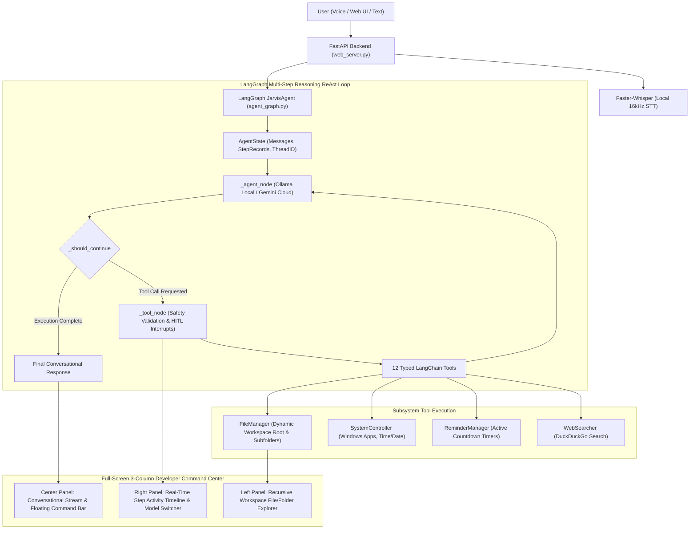

# Project Plan: Autonomous AI Desktop Assistant "Jarvis"

**Objective**
Build a high-performance, autonomous AI desktop assistant named **"Jarvis"** that runs locally on Windows. It combines a state-of-the-art **LangGraph Multi-Step Reasoning Engine**, local offline models (**Ollama `qwen2.5:3b` / `qwen2.5-coder:7b`**) with cloud fallback (**Google Gemini 2.5 Flash**), local **Faster-Whisper** speech transcription, and a modern **3-Column Developer Workspace** for autonomous multi-step software development, research, and desktop automation.

---

## 1. Current Architecture & Status

**Overall Progress: 100% Core LangGraph Agent + Dynamic Workspace + 3-Column UI Overhaul Complete**

### Architecture Diagram


---

## 2. Completed Milestones & Capabilities

### A. LangGraph Multi-Step Autonomous Agent Engine (`command_framework/agent/`)
* **StateGraph ReAct Loop:** Iterative reasoning loop that decomposes complex instructions into sequential tool invocations without manual user intervention.
* **12 Typed LangChain Tools (`agent_tools.py`):**
  1. `create_folder`: Create directories and nested subfolders in the workspace.
  2. `create_note`: Create files with any developer extension (`.py`, `.js`, `.json`, `.md`, `.txt`, etc.) and full source code.
  3. `read_note`: Read content of any file in the workspace.
  4. `modify_note`: Search-and-replace or append text to files.
  5. `delete_note`: Delete files safely.
  6. `list_files`: List directory contents.
  7. `create_excel`: Generate formatted `.xlsx` spreadsheets with columns and rows.
  8. `web_search`: Search the live web for facts, news, and research summaries.
  9. `set_timer`: Set background countdown timers.
  10. `open_app`: Launch approved Windows desktop applications.
  11. `get_time`: Fetch local system time.
  12. `get_date`: Fetch today's date.
* **Dual LLM Provider Support:**
  * **Ollama (Local):** Zero-cloud latency, privacy-first local inference using `qwen2.5:3b`, `qwen2.5-coder:7b`, or `gemma:2b`.
  * **Google Gemini (Cloud):** High-speed cloud reasoning via `gemini-2.5-flash`.
  * **Live Provider Switching:** Seamless 1-click toggling between local and cloud providers with instant state preservation.
* **Human-in-the-Loop (HITL) Safety Tiers (`safety_guard.py`):**
  * Safe operations (`create_folder`, `create_note`, `create_excel`, `modify_note`, `set_timer`) run **auto-approved**.
  * High-risk operations (`delete_note`, `open_app`) trigger LangGraph `interrupt()` for user confirmation.
  * Conversational approval resumption allows typing `"yes"`, `"proceed"`, or `"approve"` in chat to resume interrupted threads.
* **Memory Checkpointing:** `MemorySaver` preserves conversation thread history across multiple turns.

---

### B. Dynamic Project Workspace & File System (`file_manager.py`)
* **Project Working Directory Selection:** User selects or changes the working project folder at any time.
* **Strict Workspace Anchoring:** All file reads, code creation, folder structuring, and spreadsheets are anchored inside the active workspace directory.
* **Developer File Type Support:** Preserves `.py`, `.js`, `.json`, `.html`, `.css`, `.md`, `.xlsx`, `.sh`, `.yaml`.

---

### C. Modern 3-Column Developer Command Center (`web_ui/`)
* **Left Panel — Workspace Explorer:**
  * Displays active project directory name and full path tooltip.
  * Recursive expandable tree view of folders and files.
  * File size and type-specific badges.
  * New file / folder creation and instant file preview/deletion modal.
  * Real-time search filter.
* **Center Panel — Mission Control HUD:**
  * Top status navbar with Agent Status indicator (`READY`, `EXECUTING`, `AWAITING APPROVAL`).
  * Conversational chat stream with typewriter animation, markdown code rendering, and copy buttons.
  * Floating command bar with speech-to-text voice microphone and Web Audio oscilloscope.
  * Spotlight command palette (`Ctrl+K`).
* **Right Panel — Agent Management & Live Step Timeline:**
  * Provider toggle chips (Ollama Local $\leftrightarrow$ Gemini Cloud).
  * Active model badge and memory reset button.
  * Real-time **Live Step Timeline** rendering step number, tool name, input arguments, execution status, and output results.

---

## 3. Backend API Reference (`web_server.py`)

| Route | Method | Description |
| :--- | :--- | :--- |
| `/api/query` | `POST` | Processes text commands through the LangGraph ReAct agent. |
| `/api/approve` | `POST` | Resumes an interrupted thread with the user's approval decision. |
| `/api/voice_query` | `POST` | Transcribes 16kHz WAV audio using Faster-Whisper and processes with LangGraph. |
| `/api/workspace` | `GET` | Returns current active project working directory path. |
| `/api/workspace` | `POST` | Sets active project working directory and synchronizes all agent tools. |
| `/api/explorer` | `GET` | Recursively scans workspace directory and returns folder tree. |
| `/api/explorer/create_folder` | `POST` | Creates folder directly from the explorer UI. |
| `/api/explorer/create_note` | `POST` | Creates file directly from the explorer UI. |
| `/api/notes/{filename:path}` | `GET` | Reads content of any file in the workspace. |
| `/api/notes/{filename:path}` | `DELETE` | Deletes a file from the workspace. |
| `/api/timers` | `GET` | Lists all active countdown timers. |
| `/api/timers/{timer_id}` | `DELETE` | Cancels an active countdown timer. |
| `/api/agent/status` | `GET` | Returns LLM provider, active model, and tool list. |
| `/api/agent/config` | `POST` | Switches active LLM provider (`ollama` $\leftrightarrow$ `gemini`) and persists to `config.json`. |
| `/api/agent/clear` | `POST` | Clears conversation memory checkpoint thread. |

---

## 4. How to Run

1. **Start Ollama (Optional for local offline mode):**
   ```bash
   ollama run qwen2.5:3b
   ```
2. **Launch the Jarvis Server:**
   ```powershell
   python -m uvicorn web_server:app --host 127.0.0.1 --port 8000
   ```
   *Or run the batch script:*
   ```cmd
   run_web.bat
   ```
3. **Open the Web Interface:**
   Navigate to **[http://localhost:8000](http://localhost:8000)** in any browser.
